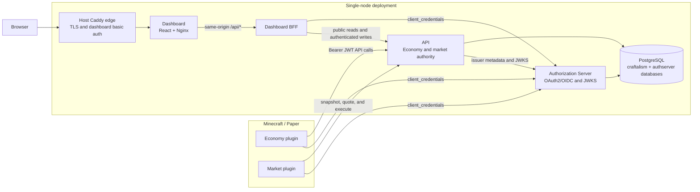

# Craftalism

[](https://openjdk.org/)
[](https://spring.io/projects/spring-boot)
[](https://react.dev/)
[](https://www.postgresql.org/)
[](https://docs.docker.com/compose/)
[](./LICENSE)

Craftalism is a multi-repository platform that moves Minecraft economy and market state into an OAuth2-secured backend. The API owns business state and contract behavior; the Minecraft plugins, dashboard, deployment, infrastructure, and operator tooling consume or support that platform.

This root repository contains the ecosystem governance layer, not an application runtime. It owns shared contracts, standards, system-level guidance, and historical audit records. Runtime commands belong to the component repositories listed below.

## Project status

The routed status documents identify the current baseline and its historical verification:

- [Status map](docs/wiki/status-map.md)
- [Latest broad platform audit](docs/audit/2026-04-10-ecosystem-platform-audit.md)
- [Release-readiness reverification](docs/audit/2026-04-08-ecosystem-release-readiness-reverification.md)

Audit files are point-in-time evidence, not current authority. Contracts and standards take precedence, and release confidence still depends on running the deployment smoke flow against the exact selected tags and image digests. The [compatibility matrix](docs/compatibility-matrix.md) currently defines the required format but contains an example rather than a recorded release set.

## Architecture



The authorization server issues RSA-signed JWTs. The API validates protected requests using the configured issuer metadata and JWKS; it does not call the authorization server for every request. The production deployment binds application services to loopback ports and relies on the infrastructure-managed Caddy edge for public HTTP and HTTPS ingress.

## Repositories

| Repository | Responsibility | Primary stack |
| --- | --- | --- |
| [`craftalism`](https://github.com/HenriqueMichelini/craftalism) | Shared contracts, standards, governance, system documentation, and audits. | Markdown, Mermaid |
| [`craftalism-api`](https://github.com/HenriqueMichelini/craftalism-api) | Authoritative players, balances, transactions, transfers, incidents, market pricing, quotes, execution, and persistence. | Java 17, Spring Boot 3.5, JPA, Flyway |
| [`craftalism-authorization-server`](https://github.com/HenriqueMichelini/craftalism-authorization-server) | OAuth2/OIDC issuer, machine-client registration, discovery metadata, and JWKS. | Java 17, Spring Boot 3.5, Spring Authorization Server |
| [`craftalism-dashboard`](https://github.com/HenriqueMichelini/craftalism-dashboard) | Economy visibility plus player, balance, and market administration through the deployment BFF. | React 19, TypeScript 5, Vite 7, Tailwind CSS 3 |
| [`craftalism-deployment`](https://github.com/HenriqueMichelini/craftalism-deployment) | Docker Compose runtime, local/test/production workflows, dashboard BFF, release-image pinning, and smoke checks. | Docker Compose, Node.js BFF, PostgreSQL 18, Nginx |
| [`craftalism-economy`](https://github.com/HenriqueMichelini/craftalism-economy) | Minecraft economy commands, API orchestration, caching, and player-facing fallback behavior. | Java 21, Paper 1.21.4, Caffeine |
| [`craftalism-market`](https://github.com/HenriqueMichelini/craftalism-market) | Minecraft market GUI, snapshot cache, quote consumption, trade execution, and inventory settlement. | Java 21, Paper 1.21.4 |
| [`craftalism-infra`](https://github.com/HenriqueMichelini/craftalism-infra) | Single-node AWS infrastructure, ingress policy, host bootstrap, Caddy TLS edge, and host monitoring. | Terraform, AWS, Caddy |
| [`craftalism-workstation`](https://github.com/HenriqueMichelini/craftalism-workstation) | Local governance-aware repository navigation, verification, and release-readiness tooling. | Shell scripts |

## Core behavior

### Economy

When a player joins, the economy plugin ensures that the API has a player and balance record and caches read results locally. The canonical `/pay` path is `POST /api/balances/transfer`, with an idempotency key; the API performs the balance movement and transaction recording atomically.

The economy plugin also contains a legacy withdraw/deposit fallback. It is disabled by default (`pay-legacy-fallback-enabled: false`) and, when explicitly enabled, is a degraded non-atomic path with compensation risk. See the [transfer flow contract](docs/contracts/transfer-flow.md).

### Market

The market plugin renders `/market` from the API snapshot, requests quantity-sensitive quotes, and executes buys and sells with API-issued quote tokens and the opaque `snapshotVersion`. Pricing, stock, momentum, rejection decisions, and durable market state remain API-owned. Cached snapshots may be used only for read-only degraded browsing when execution is unavailable. See the [market contract](docs/contracts/market-contract.md).

### Dashboard

The dashboard displays players, balances, transactions, market trades, categories, items, events, and event templates. Implemented administrative flows include player and balance changes plus market category, item, event, event-template, and drift-reset operations.

Browser requests remain same-origin. In the composed stack, Nginx forwards `/api/*` to the deployment-owned dashboard BFF. The BFF allows public reads, obtains scoped machine tokens for an allowlist of writes and protected market-admin reads, and keeps OAuth client secrets out of browser code.

## API surface and access model

| Area | Main routes | Current access |
| --- | --- | --- |
| Players | `/api/players` | `GET` is public; writes require `api:write`. |
| Balances and transfers | `/api/balances`, `/api/balances/transfer` | `GET` is public; writes require `api:write`. |
| Transactions | `/api/transactions` | `GET` is public; writes require `api:write`. |
| Transfer incidents | `/api/transfer-incidents` | `GET` is public. |
| Market | `/api/market/snapshot`, `/api/market/trades`, `/api/market/quotes`, `/api/market/execute` | Snapshot and trade reads are public; quote and execute require `api:write`. |
| Market administration | `/api/dashboard/market/*` | Event, event-template, and drift routes require `market:admin`; category and item writes require `api:write`. |

Most validation and domain errors use Spring `ProblemDetail`. Market business rejections use the separate stable-code payload defined by the market contract. The canonical transaction paths are documented in the [transaction routes contract](docs/contracts/transaction-routes.md).

Swagger UI is available at `/api-docs` and the OpenAPI document at `/v3/api-docs` when SpringDoc is enabled. Local Compose enables both; production disables both by default.

## Run locally

The supported full-stack workflow lives in `craftalism-deployment`.

### Prerequisites

- Git
- Docker Engine 20.10+
- Docker Compose v2+
- JDK 21 for local economy and market plugin builds
- At least 4 GB of available RAM

### Start the stack

```bash
git clone https://github.com/HenriqueMichelini/craftalism-deployment.git
cd craftalism-deployment
./local
```

`./local` creates `.env` and `.env.local` from the included examples when absent, clones or updates the required sibling repositories, builds both plugin JARs, and starts the Compose stack from local sources. If sibling repositories already exist, the bootstrap script fetches them and may check out and fast-forward their configured branches; review the [deployment README](https://github.com/HenriqueMichelini/craftalism-deployment#readme) before using it in a workspace with local branch work.

Local endpoints:

| Service | URL |
| --- | --- |
| Dashboard | `http://localhost:8080` |
| Authorization Server | `http://localhost:9000` |
| API | `http://localhost:3000` |
| Swagger UI | `http://localhost:3000/api-docs` |
| Minecraft | `localhost:25565` |

Verify the HTTP services:

```bash
curl -f http://localhost:9000/actuator/health
curl -f http://localhost:3000/actuator/health
curl -f http://localhost:8080/
```

Stop the stack from the deployment repository:

```bash
./local down
```

For staging and production, follow the deployment repository's `./test` and `./prod` workflows. Production requires immutable service versions and image digests, persistent RSA keys, non-placeholder database/RCON/OAuth secrets, aligned issuer configuration, and the infrastructure-managed host edge. Do not treat the example `.env` values as production-ready.

## Documentation and contribution workflow

Start with the documentation router rather than scanning the full documentation tree:

1. Read [`docs/index.md`](docs/index.md).
2. Read [`docs/wiki/index.md`](docs/wiki/index.md).
3. Follow the smallest routed set of contracts and standards for the task.
4. For component work, continue with that repository's `AGENTS.md`, `docs/repo-contract-map.md`, and `docs/repo-requirement-pack.md`.

Useful root references:

- [Governance precedence](docs/governance-precedence.md)
- [System summary](docs/system-summary.md)
- [Contracts map](docs/wiki/contracts-map.md)
- [Standards map](docs/wiki/standards-map.md)
- [Codex usage checklist](docs/codex-usage-checklist.md)
- [AI delivery workflow](docs/workflows/ai-delivery-workflow.md)
- [Technical card template](docs/templates/technical-card.md)

This repository has no application build or test command. Run verification in the component repository being changed; each component documents its own Gradle, npm, Compose, Terraform, or shell workflow.

## Known limitations

- Most API `GET` routes are intentionally public for the current dashboard model. This is a weak trust boundary even when the dashboard itself is protected by edge basic auth.
- The dashboard has no end-user OAuth login or application-level RBAC. Its BFF uses machine credentials, so API writes are not attributed to individual dashboard users.
- The economy legacy transfer fallback is non-atomic and disabled by default.
- The production baseline is a hobby-scale, single-node deployment. `t3.small` requires conservative memory limits and swap; `t3.medium` is the safer floor for non-trivial load.
- The compatibility matrix is not yet populated with an exact, validated multi-repository release set.
- CI and test depth remain uneven across the repositories; use the exact-release deployment smoke flow for cross-service validation.

## Author

**Henrique Michelini**

- [LinkedIn](https://www.linkedin.com/in/henrique-giammellaro-michelini/)
- [GitHub](https://github.com/HenriqueMichelini)

## License

MIT. See [`LICENSE`](./LICENSE) for details.
